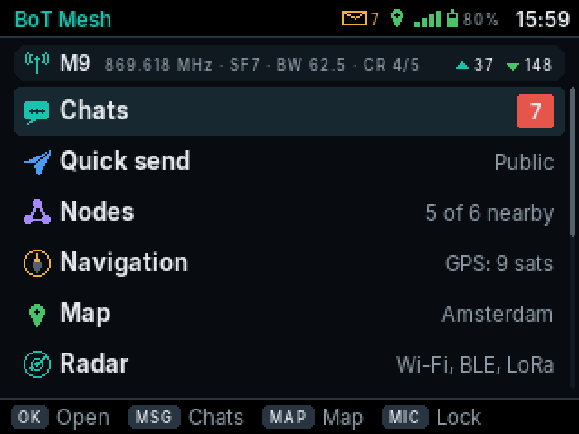
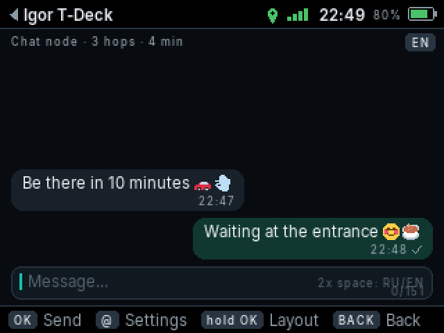
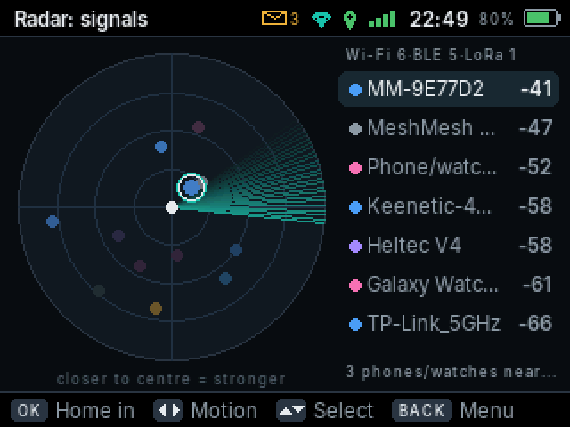

# BotMesh

This is the Bas on Tech MeshCore firmware

It is based on [MeshMesh](https://github.com/IKrasnodymov/meshmesh). However over time there are so many changes in code and UI that it developed on its own.

Differences between MeshMesh:
- Only supports ThinkNode M9 and Heltec v4
- Only supports English
- List interface for quick navigating
- Different UI approach

---

**Website and one-click browser install: https://basontech.github.io/meshmesh-bot/**

Off-grid messaging firmware for the ThinkNode M9 and Heltec V4 LoRa devices. Messages hop by radio from device to
device, with no internet, no cell network and no servers. The radio layer is
[MeshCore](https://github.com/meshcore-dev/MeshCore), so MeshMesh nodes talk to standard
MeshCore nodes.

<p>



</p>

## Features

- **Chats** — direct and public messages, ✓✓ delivery receipts, retries, route shown per message; about 300 common emoji drawn on the screens, in colour on colour screens (0.32.0).
- **Channels** — up to 8 MeshCore channels: join by #hashtag, `meshcore://` link or QR code, name and key;
  create a private one, invite contacts by direct message, find channels heard on air. [docs/channels.md](docs/channels.md)
- **Regions** — MeshCore flood scope: a default region and one per channel, a search of the regions nearby repeaters serve; repeaters set up with the `region` commands. [docs/regions.md](docs/regions.md)
- **Backup** — settings, channels with keys, contacts, Quick Send, counters, character sheets and, optionally, the node key in one JSON file from the device page or the app; a restore shows what will change and writes only what you tick, to the same or another board (0.30.0). [docs/backup.md](docs/backup.md)
- **Offline maps** — OpenStreetMap with relief and contour lines, kept on the phone (app) or the device SD card; nodes, direct links and GPS on the map, with any board.
- **Wardriving** — a coverage map of the mesh: packets heard and channel pings with the repeaters that pass them on, logged with a trusted GPS or phone position; Wi-Fi and Bluetooth too on ESP32; export to CSV, GeoJSON, KML and WiGLE. [docs/wardrive.md](docs/wardrive.md)
- **Nearby nodes** — signal, hops, distance and bearing; contacts, repeaters and rooms.
- **Signal radar** — Wi-Fi, Bluetooth and LoRa around you, with “warmer / colder” homing.
- **Motion sensor** — two boards detect a person walking between them (Wi-Fi CSI).
- **Chess** with your contacts over the mesh, and Klondike solitaire on the M9.
- **Checkers and sea battle** with your contacts over the mesh (0.33.0): Russian draughts and a 10×10 sea battle, each move an acknowledged message, no rating; all games sit in a Games folder of the menu, and folders can be created, renamed, hidden and filled on the web page or in the app. [docs/games.md](docs/games.md)
- **Mesh pet** — a Tamagotchi-like pixel creature on every board that feeds on radio traffic, grows up and can die of hunger or loneliness. [docs/pet.md](docs/pet.md)
- **Dice** — the DIC3R dice roller on every board: RPG pools and formulas (2d6+1, d20, d66, d%), a Warhammer grid with a success threshold and a character sheet of blocks (stats, tracks, marks, abilities that roll and spend) with D&D 5e and R.E.T. templates, built on the web page or in the app and sent to a contact over the mesh; the same on the screen, the web page and the app. [docs/dice.md](docs/dice.md)
- **Chess without MeshMesh on your device**: [the chess page](https://basontech.github.io/meshmesh-bot/chess/) plays through a
  board running the official MeshCore Companion firmware, over USB (Web Serial) or Bluetooth (Web Bluetooth), in Chrome or Edge.
- **Repeater and room server modes** — chosen at boot (M9 screen, Heltec button) or in Settings,
  on the web page, over USB: the device becomes a stock-compatible MeshCore repeater or room server
  with admin login and remote CLI from the MeshCore app; key, contacts and history stay.
  [docs/repeater.md](docs/repeater.md)
- **MeshCore apps** — the stock MeshCore apps connect over Bluetooth or USB and work with the board's chats, contacts and channels (chess stays in the MeshMesh app). [docs/companion.md](docs/companion.md)
- **GPS and compass**, position sharing, lock screen.
- **Web interface** over the device's own Wi-Fi access point or the home Wi-Fi it joins (M9).
- **Device UI in English** (Dutch is planned); the web interface too.

## Boards

| Board | Status |
|---|---|
| Elecrow ThinkNode M9 (keyboard, 320×240 screen) | tested on hardware |
| Heltec WiFi LoRa 32 V4 (OLED, one button) | tested on hardware |
| Heltec WiFi LoRa 32 V4-R8 (8 MB PSRAM revision) | builds; not yet run on hardware |

This fork supports only these boards; the original MeshMesh also builds for nRF52 and other ESP32 boards.

## Install

**Browser:** open the [website](https://basontech.github.io/meshmesh-bot/#install) in Chrome or
Edge on a computer, pick your board and the device language, press **Install**. Updating MeshMesh
keeps your key, contacts, settings and history; tick “Erase device” only when coming from other firmware.

**esptool:** download the board's zip from the website and run

```sh
python -m esptool --chip esp32s3 --port PORT write-flash --flash-mode dio --flash-freq 80m --flash-size 16MB \
  0x0 bootloader.bin 0x8000 partitions.bin 0xe000 boot_app0.bin 0x10000 firmware.bin
```

Default radio: the Netherlands preset, 869.618 MHz, BW 62.5 kHz, SF7, CR4/5 — change it in Settings → Radio; all nodes
of a network must match. Follow your country's radio regulations.

## Build

```sh
python3 -m venv .venv
.venv/bin/pip install -r tools/requirements.txt
.venv/bin/pio run -e m9            # or heltec_v4, heltec_v4_r8
.venv/bin/python tools/build/package.py m9
```

The screen UI can be rendered on a computer without a board: `tools/ui_preview/build.sh m9 OUTDIR en`.

Theme colours (`0xRRGGBB` in `src/ui/themes/*.h`) get VS Code's colour swatch and picker with a small
local extension: `tools/vscode_hex_color/install.sh` (or `install.sh code-insiders`), then reload the
window. Hover a swatch to pick a colour; it is written back as `0xRRGGBB`. Other files can be enabled
with the `hex0xColor.include` glob setting.

## Documentation

Detailed documentation: [channels](docs/channels.md), [regions](docs/regions.md), [backup](docs/backup.md), [MeshCore compatibility](docs/meshcore-migration.md),
[repeater and room modes](docs/repeater.md),
[chess protocol](docs/chess.md), [mesh pet](docs/pet.md), [dice](docs/dice.md), [map format](docs/maps-format.md), [comparison with MeshCore](docs/feature-parity.md),
[hardware verification](docs/verification.md).

Not verified yet: LoRa range, GPS accuracy under open sky, compass accuracy, relaying through a
third repeater. Not implemented: voice, route planning, OTA updates.

## License

[MIT](LICENSE). Bundled MeshCore (`lib/MeshCore`) keeps its own MIT license. Screen emoji are drawn from [Twemoji](https://github.com/jdecked/twemoji) graphics by Twitter, Inc and other contributors, [CC-BY 4.0](https://creativecommons.org/licenses/by/4.0/). Text on the M9 screen is drawn with [Inter](https://rsms.me/inter/) by Rasmus Andersson, [SIL Open Font License 1.1](i18n/fonts/inter/OFL.txt). Map data ©
[OpenStreetMap](https://www.openstreetmap.org/copyright) contributors. The radar idea follows
the RSSI tracker and radar HUDs by [Stevee87](https://github.com/Stevee87).

Release 0.4.0: [event waits on every board](docs/power.md) and [independent firmware/Android versions and publishing](docs/releases.md). Battery-life gains have not been measured.

Firmware 0.4.1 reduces history-export memory use and reports allocation failures explicitly; Android remains 0.4.0.

Firmware 0.26.0: the sheet's block builder on the M9 and T-Deck screens (E edits a block, A adds one); every board adds a ready D&D 5e and R.E.T. character once.

Firmware 0.25.0 and Android 0.18.0: the [character sheet](docs/dice.md#the-character-sheet) replaces the dice counters (they become its tracks); D&D 5e and R.E.T. templates, formulas between blocks, sending a sheet to a contact; the nRF52 libraries are built for size (`-Os`).

Firmware 0.8.1: switching off also writes the dice counters changed in the last two seconds.

Firmware and Android 0.8.0: switch the device off from the Settings menu on its screen, the web page, the app or the USB command `poweroff`; it saves its data, shows "Device is off" and how to turn it on, then enters deep sleep (ESP32), a soft off (nRF52: everything off, the CPU waits for the button) or is cut off by its PMU (T-Beam). Holding the button for about a second, RESET or the power switch turns it on, depending on the board ([docs/power.md](docs/power.md#power-off)).

Firmware and Android 0.7.0: [dice](docs/dice.md) — the DIC3R roller (RPG pools and formulas, a Warhammer grid with a success threshold, counters, characters) on every board, the web page and the app; on the T114 and GAT562 chess, the pet and the dice are [optional modules](docs/gat562.md#modules-chosen-before-installing) chosen when building (`tools/nrf52.py package ENV --without …`). Dice checked on the M9 by the owner; the module images not yet on a board.

Firmware and Android 0.6.0: reply to a chat message by swiping it from right to left, as in Telegram (double-click on a computer); a channel reply starts with the `@[Name]` mention, a direct one with a short `> …` quote. Checked in the Android emulator's Chrome with test data, not with a board.

Firmware 0.5.1: the Heltec V3 build uses the DIO flash driver, matching its image header (a user's V3 did not keep writes with the QIO driver libraries; not yet verified there); `flashstatus` names the driver mode and `flashprobe` also writes through the ROM functions, as esptool does.

Firmware 0.4.3: when the LittleFS partition does not keep writes (as on a user's Heltec V3), `fsformat` puts the storage into the free OTA slot; the USB commands `flashstatus` and `flashprobe` show the flash chip and where writes stop staying.

Firmware 0.4.2: messages recorded before the clock is set get their exact time once it is set; a spoofed GPS date earlier than the firmware build, or one contradicting the phone/NTP time, is rejected. Android 0.4.1 does not repeat message notifications after that.

[Notifications, quick send, channel retention, periodic NTP and quick counter](docs/notifications.md).
